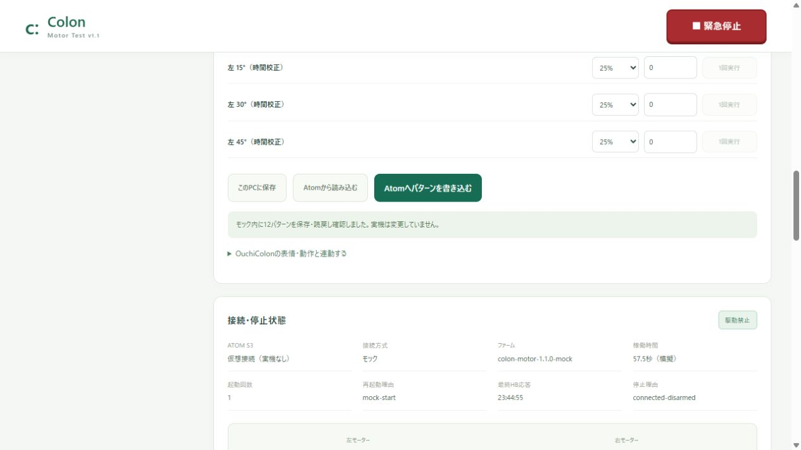

# Web通信・A10の修正（2026-11-08）

A10は後進0.5秒 → 停止1秒 → 前進0.5秒の各1回に変更しました。左右の旋回時間2/4/6/12秒、100%出力、ファームウェア1.8.0は変更していません。今回のWeb修正のための再書込みは不要です。

旧処理では状態読取り150ms周期と心拍120ms周期が競合し、読取り120ms・書込み40msの遅延条件で心拍切れによる途中停止を再現しました。修正後は両画面とも通信を1つのスケジューラで管理し、駆動中の状態読取り前に心拍を優先します。同じ遅延条件の決定的テストではA01相当が3回とも2000msで正常終了しました。Chromeの疑似GATTでも3回とも正常終了（2001/2000/2004ms）を確認しました。実機で今回の症状が起きた原因そのものは未確認です。

本体の心拍断350ms停止、切断停止、動作時間上限、停止後の再始動禁止は維持しています。350ms以上通信が途切れる場合は意図的に停止し、自動で残り時間を走り直す処理はありません。表示には日本語の停止理由と、同じ接続中の直近の心拍切れ時刻を追加しました。後続のSTOPで停止理由が変わっても、その記録は接続し直すまで残ります。検出はブラウザが本体状態を読めた場合に限ります。

| 確認 | 結果 |
|---|---|
| Web全体 | 316件成功 |
| C++制御コア・液晶 | 54ケース成功 |
| TypeScript / Vite | ビルド成功（既存のチャンクサイズ警告あり） |
| Chrome UI | 疑似BLE遅延・A01を3回、A10、WASD、取消・切断・再接続、Colon連動、レスポンシブ表示が成功 |

合計370件に加え、Chrome画面試験が成功しました。モーターやBLE実機は操作せず、本体への書込みはしていません。時間による旋回のため、電池・床面・負荷による実角度のばらつきはこの修正で保証できません。

[Web試験](reports/steady-motor-web-tests.txt) / [C++試験](reports/steady-motor-native-tests.txt) / [ビルド](reports/steady-motor-build.txt) / [Chrome試験](reports/steady-motor-browser-tests.txt)

再試験はWeb画面をCtrl+F5で再読込みし、BLEを接続し直してA01を1回ずつ実行してください。途中停止時は「停止理由」と「直近の心拍切れ」を確認します。A10の初期停止時間が1000msと表示されることも確認してください。

---

以下は共通旋回時間を追加した時点の記録です。

# 1.8.0 共通旋回時間の検証（2026-11-08）

ユーザー指定により左右15/30/45/90°=2/4/6/12秒を初期設定にしました。基本パターン形式6、NVSはpatterns-v6です。片側の編集・本体保存はもう片側の同じ角度へ反映され、角度指定の全動作で共通の値を使います。旧v3/v4/v5の旋回設定は新しい初期値へ置き換えます。

| 確認 | 結果 |
|---|---|
| Web全体 | 311件成功 |
| 実C++制御コア | 54ケース成功 |
| 追加の共通時間・配布チェック | 23件成功（上記Webに含まれるケースの確認） |
| TypeScript / Vite | ビルド成功。既存mainチャンクサイズ警告あり |
| AtomS3 firmware 1.8.0 | PlatformIOビルド・ESP32-S3の4分割パッケージ作成成功、SHA-256/MD5照合 |
| Chrome UI | 2000/4000/6000/12000msの左右初期表示、片側編集の反対側同期、保存・読戻し、WASD、複合動作・停止・切断・Colon連動、レスポンシブ表示が成功 |

WebとC++合計365件が成功しています。12秒駆動の独立上限、12秒を超える指令の拒否、動作中の心拍断350ms停止、旧1.7.0への12秒送信拒否を確認しました。パターンのビルドタグ増加に合わせ、GATTパターンJSONのバッファを512byteへ拡張しました。

[Web](reports/common-turn-web-tests.txt) / [C++](reports/common-turn-native-tests.txt) / [追加確認](reports/common-turn-focused-tests.txt) / [本番ビルド](reports/common-turn-build.txt) / [本体ビルド](reports/common-turn-firmware-build.txt) / [ブラウザ](reports/common-turn-browser-tests.txt)

実機の書込み・モーター通電・実角度測定は行っていません。今回の共通時間には1.8.0への更新が必要です。[実機で試す順番](actions.md#試す順番)

以下は1.7.0以前の記録です。

---

# 整合性の再確認（2026-11-08・Web修正後）

Web305件・実C++制御コア52ケース、計357件が成功しました。画面・保存値・配布ファーム・ログ・説明書を照合した結果と修正内容は [整合性確認](consistency-audit.md) を参照してください。ファーム1.7.0と本体バイナリは変更していません。

以下は初回実装時の記録です。

---

# Motor Control 1.7.0 検証記録（2026-11-08）

対象はA01〜A17のブラウザ実行処理、AtomS3専用ファーム1.7.0、基本校正パターン形式5です。実機USB選択・実機書込み・BLE実機接続・モーター通電は行っていません。

| 確認 | 結果 |
|---|---|
| 既存会話・顔処理を含む `npm test` | 298件成功、失敗0 |
| 実ファームのC++17コア `npm run test:motor-native` | 52ケース成功、警告をエラー扱い |
| TypeScript + Vite本番ビルド | 成功。従来からの大きなmainチャンクの警告あり |
| PlatformIO `atoms3-program` | ビルド成功、RAM47,140bytes・Flash1,307,213bytes |
| USB配布パッケージ | 1.7.0・ESP32-S3・4分割・NVS非重複・SHA-256/MD5検証 |
| Chrome画面試験 `npm run test:motor-browser` | モック・疑似BLEとも成功、1280px/390px幅を確認 |

[Webテスト](reports/actions-web-tests.txt) / [C++テスト](reports/actions-native-tests.txt) / [本番ビルド](reports/actions-web-build.txt) / [ファームビルド](reports/actions-firmware-build.txt) / [ブラウザ結果](reports/actions-browser-tests.txt)

Web/C++合計350件に、別途Chromeの画面試験が成功しています。新規試験は番号17個の整合、100%固定、右左の極性、90°未校正の拒否、顔の左右・見かけの大きさと期限、A07の連続2秒と停止後発話、A10の6パルス/5回の200ms停止、途中取消・切断・再起動・心拍断・顔消失による後続中止、重複STOPとESTOP優先、旧ファームや上限超過の拒否です。

ChromeではW/Sの押下・解放、A/Dの校正済み90°、キーリピートの抑制、No. 1/2、90°校正の保存、A08/A09/A10、A17で残りを取り消して接続保持、再接続後の連動OFF、Colon会話入力→A07→停止→到着音声、ラジコンの言葉「前」→A13、顔消失時の中断、緊急停止を確認しました。Bluetooth機器は選択せず、疑似GATTとローカルモックを使用。音声はOS出力ポートだけをモックにし、Colonの実際の音声エンジン・完了通知を通しました。カメラ画像やマイク音声の実機試験ではありません。

再現には先に開発サーバーを18181で起動し、WindowsのChromeが必要です。別の場所のChromeは環境変数`CHROME_BIN`で指定できます。

動作角・移動距離・電池電圧・電流・物理的な停止は未測定です。[未解決事項](risks.md) / [実機試験手順](actions.md#試す順番)

---

以下は旧版の記録です。

# 検証記録（2026-11-05）

対象：`feature/motor-test-v1`、AtomS3信号試験ファーム `colon-motor-1.1.0` と本体単独版 `colon-motor-1.2.0`。実機USB選択・実機書込み・BLE実機接続・モーター通電は実施していません。

## 2026-11-05 本体単独版1.2

ユーザーが1.5V想定・未測定での本体テストを指定したため、標準1.1と別の限定ファームを追加しました。通常運転の電源適合はfalseのまま、単体75%以下・100ms上限・1000Hz固定をファーム側で強制し、通常／信号ARMでの回避、両輪駆動、パターン実行を拒否します。測定値を作らず、ログへ想定1.5Vとuser-assumptionを記録します。連動は保留です。[実機手順](single-motor-test.md)

本体単独版のPlatformIOビルド成功：RAM45,140bytes、Flash910,277bytes。既存1.1配布バイナリは維持しました。新しいmanifestはexperimental-single、powerQualified:false、assumedV:1.5、maxPulseMs:100、maxDuty:75を明記し、SHA-256・MD5とNVSを避ける配置を確認しています。ブラウザのモックで単体のみ許可・走行とパターン無効・緊急停止ラッチ、USB欄の新パッケージ準備完了を確認。実機書込み・通電は代行していません。

単独版を含むWeb267件、モーター関連44件、実C++コア27ケースが成功。新規ケースは片側100ms停止、出力・同時駆動・長いパルスの拒否、ARMモードの回避防止、再接続後の停止、未測定の出典、配布パッケージの条件検証を含みます。[単独版ビルド出力](reports/firmware-single-build.txt)

## コード試験

| 確認 | 結果 |
|---|---|
| 既存OuchiColonを含む `npm test` | 267 / 267成功（既存222＋追加45） |
| `npm run test:motor` | モーター・パターン・USB・通信競合・単独版の44件成功 |
| `npm run test:motor-native` | 実ファーム用C++コア27ケース成功、g++ C++17 / 警告をエラー扱い |
| TypeScript + Vite本番ビルド | 成功、`npm run build -- --configLoader runner` |
| PlatformIO ESP32-S3ビルド | 成功、Arduino2.0.17 / espressif32 6.12.0 / 8MB |
| 同梱ファーム | RAM45,132bytes、Flash909,889bytes、アプリbin910,256bytes |
| 配布パッケージ | 4分割、チップID9、NVSとの非重複、通電ロックタグ0、SHA-256 / MD5生成 |
| 状態JSON最大値検算 | 単独版は最長を想定した値で492bytes、512byteバッファ以内 |
| `git diff --check` | 問題なし |

## USBツール読込みの修正

開発画面の接続クリック時に `/.vite/deps/esptool-js.js` が504（Outdated Optimize Dep）になる現象を再現しました。開発依存の追加変換が実行環境の読取り制限で失敗していました。公式パッケージ内の依存を含むブラウザ用 `bundle.js` を使用し、開発時の追加変換対象から除外しました。

ページ表示時にファームと書込みツールを準備し、準備完了後の接続クリック内で追加読込みを挟まずUSB選択を呼び出します。未対応ブラウザ、準備待ち、確認項目不足を画面に明記しました。新しい開発URLでモジュールとバンドルのHTTP200、実ブラウザで準備完了表示と読込みエラーなしを確認。実際のバンドルを読み込む追加テストでは、準備中にnavigatorへアクセスしないことも確認しました。実機接続・リセット・書込みはしていません。

追加試験を含むモーター関連44件、全Web試験267件が成功し、TypeScript・Vite本番ビルドも成功しました。

## パターン操作ボタンの点滅・通信競合の修正

定期的な状態読取り・心拍の最中に、操作ボタンを無効化していたため点滅し、クリック時にも通信中エラーになる問題を修正しました。通信回線の使用中とユーザー操作の処理中を分け、定期通信だけでは読取り・保存ボタンを無効にしません。読取り・保存・許可操作は進行中の通信が終わった次の枠を予約し、それ以降の定期通信の割込みを防ぎます。12件の保存と読戻し、設定と許可もそれぞれ一続きの処理としました。

待機中・保存中の停止や切断で操作を取り消し、緊急停止を優先します。動作要求は待ち行列へ入れず、読み込み中の動作要求は送信しません。応答のない読取りは切断し、処理中表示を解除します。ファームや独立停止タイマーは変更していません。

遅い定期通信との競合、保存への割込み抑止、停止による待機許可の取消し、保存途中の緊急停止、無応答からの復帰、設定・許可の連続処理の6件を追加。ブラウザのモックでもパターン読取りと12件保存・読戻し、処理後のボタン有効状態、エラーなしを確認しました。今回の修正後に実機の再接続・読取りは代行していません。

通常のVite設定ローダーは、このWindows実行環境で上位ディレクトリの読取りを拒否されました。runner指定でビルド成功。元からある顔画面の約798KBチャンクに500KB超の警告があります。ビルドエラーではありません。

自動試験は起動停止、未許可拒否、左右独立、方向切替、パルス上限、心拍タイムアウト、切断・再接続、古いフレーム拒否、緊急停止ラッチ、PWM不正値、GPIO競合、ログの出典区別、12パターン保存・読戻し・モック再起動保持、未校正旋回拒否を含みます。USBは疑似ローダーによるチップ・容量判定、分割書込み、全消去禁止、MD5不一致検出と自動再起動禁止を確認しました。実機USBプロトコルを実行した試験ではありません。

## ブラウザでの操作確認

- 連動設定への移動：独立画面でCSSのdisplay指定がhidden属性を上書きし、使わない割当欄が見えていた問題を修正。モック接続中でも割当・連動ON欄が表示されず、リンクから同じタブで顔画面へ移動し、連動パネルが開くことを確認。移動前に停止要求と切断を行い、移動先は未接続・連動OFFです。本番ビルド成功。実機の接続・制御は代行していません。

- Motor Test：モック接続、パターン読み込み、安全確認後の前進25%。200msの上限停止、許可解除、未校正旋回の実行禁止を確認。
- USB欄：同梱ファーム1.1.0のSHA-256準備完了表示。安全確認前の接続・書込みボタンが無効。実機ボタンは操作していません。
- オフラインキャッシュの版を更新し、新しい入口を取得できるようにしました。ファーム一覧とバイナリはキャッシュを使わず取得します。この挙動も自動試験で確認。
- 顔画面：既存デバッグUIと追加パネルを確認。HAPPYへ前進25%を割当し、既存キー2で表情変更。パターン要求と `stopped:pulse-limit`、次の実行が再許可待ちになることを確認。
- 顔画面：追加パネルを閉じても固定緊急停止を押せること、緊急停止ラッチ、許可禁止、切断後に固定ボタンが消えることを確認。
- 本番ビルドの別ポートでも従来の顔と追加パネルが起動することを確認。カメラ・認識・TTSは初期OFF、描画約27FPS、ブラウザの初期化エラーなし。音声やカメラの実機試験は実施していません。
- 実機の停止時間、GPIO波形、モーター角度、スマートフォン実機、USBバックアップの復元は未検証。

## ログと成果物

- [全Webテスト出力](reports/web-tests.txt)
- [ファームウェアビルド出力](reports/firmware-build.txt)
- [モック診断JSON](reports/mock-sample.json) / [CSV](reports/mock-sample.csv)：8件。全て模擬データ、設定電圧1.5V・実測未入力。実測ログではありません。
- [配布ファームの配置とハッシュ](../../public/firmware/manifest.json)

## 変更箇所

- `src/entry.ts`、`index.html`：従来画面とMotor Testの入口。
- `public/sw.js`、`tests/service-worker.test.ts`：既存利用者への画面更新とファームのキャッシュ除外。
- `src/main.ts`：表情名通知のimportと1呼出し、非同期起動でload後に読み込まれてもPWA登録する処理。
- `src/motor/`：独立画面、BLE・モック通信、制御セッション、診断、USB書込み、12パターン、顔画面の任意連動パネル。
- `firmware/motor-test/`：AtomS3用Arduinoコード、独立停止コア、パターンNVS保存、C++試験。
- `public/firmware/`：ビルド済みの通電禁止ファーム4分割と検証ハッシュ。
- `tests/motor-*.test.ts`、`scripts/`：自動試験と配布パッケージ作成。
- `package.json` / lock、`.gitignore`、README、`docs/motor-test/`：依存関係・手順・リスク・検証記録。

実機で進める順番はバックアップと導入確認 → Atom単体 → VMなしのGPIO・DRV8835信号 → 電源・電流の適合確認 → 別の通電許可ビルド → 左右単体 → 浮かせた走行 → 角度時間校正 → 表情連動です。正式な信号割当はG5=AIN1、G6=AIN2、G7=BIN1、G8=BIN2、MODE=GND、VCC=3.3V。[配線表](hardware.md)と[未解決リスク](risks.md)を確認してください。
