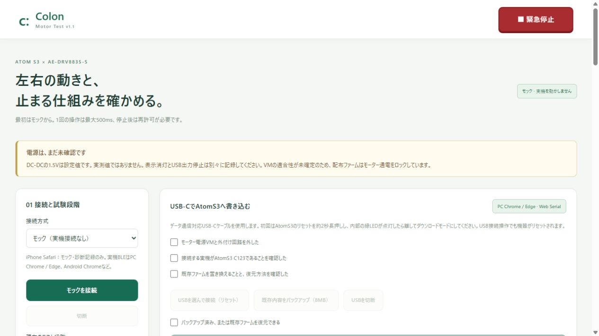

# 検証記録（2026-11-04）

対象：`feature/motor-test-v1`、AtomS3信号試験ファーム `colon-motor-1.1.0`。実機USB選択・実機書込み・BLE実機接続・モーター通電は実施していません。

## コード試験

| 確認 | 結果 |
|---|---|
| 既存OuchiColonを含む `npm test` | 253 / 253成功（既存222＋追加31） |
| `npm run test:motor` | モーター・パターン・USBの30件成功 |
| `npm run test:motor-native` | 実ファーム用C++コア18ケース成功、g++ C++17 / 警告をエラー扱い |
| TypeScript + Vite本番ビルド | 成功、`npm run build -- --configLoader runner` |
| PlatformIO ESP32-S3ビルド | 成功、Arduino2.0.17 / espressif32 6.12.0 / 8MB |
| 同梱ファーム | RAM45,132bytes、Flash909,889bytes、アプリbin910,256bytes |
| 配布パッケージ | 4分割、チップID9、NVSとの非重複、通電ロックタグ0、SHA-256 / MD5生成 |
| 状態JSON最大値検算 | 最長を想定した値で473bytes、512byteバッファ以内 |
| `git diff --check` | 問題なし |

通常のVite設定ローダーは、このWindows実行環境で上位ディレクトリの読取りを拒否されました。runner指定でビルド成功。元からある顔画面の約798KBチャンクに500KB超の警告があります。ビルドエラーではありません。

自動試験は起動停止、未許可拒否、左右独立、方向切替、パルス上限、心拍タイムアウト、切断・再接続、古いフレーム拒否、緊急停止ラッチ、PWM不正値、GPIO競合、ログの出典区別、12パターン保存・読戻し・モック再起動保持、未校正旋回拒否を含みます。USBは疑似ローダーによるチップ・容量判定、分割書込み、全消去禁止、MD5不一致検出と自動再起動禁止を確認しました。実機USBプロトコルを実行した試験ではありません。

## ブラウザでの操作確認

- Motor Test：モック接続、パターン読み込み、安全確認後の前進25%。200msの上限停止、許可解除、未校正旋回の実行禁止を確認。
- USB欄：同梱ファーム1.1.0のSHA-256準備完了表示。安全確認前の接続・書込みボタンが無効。実機ボタンは操作していません。
- オフラインキャッシュの版を更新し、新しい入口を取得できるようにしました。ファーム一覧とバイナリはキャッシュを使わず取得します。この挙動も自動試験で確認。
- 顔画面：既存デバッグUIと追加パネルを確認。HAPPYへ前進25%を割当し、既存キー2で表情変更。パターン要求と `stopped:pulse-limit`、次の実行が再許可待ちになることを確認。
- 顔画面：追加パネルを閉じても固定緊急停止を押せること、緊急停止ラッチ、許可禁止、切断後に固定ボタンが消えることを確認。
- 実機の停止時間、GPIO波形、モーター角度、スマートフォン実機、USBバックアップの復元は未検証。

## ログと成果物

- [全Webテスト出力](reports/web-tests.txt)
- [ファームウェアビルド出力](reports/firmware-build.txt)
- [モック診断JSON](reports/mock-sample.json) / [CSV](reports/mock-sample.csv)：8件。全て模擬データ、設定電圧1.5V・実測未入力。実測ログではありません。
- [配布ファームの配置とハッシュ](../../public/firmware/manifest.json)

## 変更箇所

- `src/entry.ts`、`index.html`：従来画面とMotor Testの入口。
- `public/sw.js`、`tests/service-worker.test.ts`：既存利用者への画面更新とファームのキャッシュ除外。
- `src/main.ts`：表情名通知のimportと1呼出しだけ追加。
- `src/motor/`：独立画面、BLE・モック通信、制御セッション、診断、USB書込み、12パターン、顔画面の任意連動パネル。
- `firmware/motor-test/`：AtomS3用Arduinoコード、独立停止コア、パターンNVS保存、C++試験。
- `public/firmware/`：ビルド済みの通電禁止ファーム4分割と検証ハッシュ。
- `tests/motor-*.test.ts`、`scripts/`：自動試験と配布パッケージ作成。
- `package.json` / lock、`.gitignore`、README、`docs/motor-test/`：依存関係・手順・リスク・検証記録。

実機で進める順番はバックアップと導入確認 → Atom単体 → VMなしのGPIO・DRV8835信号 → 電源・電流の適合確認 → 別の通電許可ビルド → 左右単体 → 浮かせた走行 → 角度時間校正 → 表情連動です。正式な信号割当はG5=AIN1、G6=AIN2、G7=BIN1、G8=BIN2、MODE=GND、VCC=3.3V。[配線表](hardware.md)と[未解決リスク](risks.md)を確認してください。
